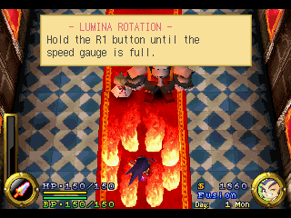

**English** · [Português (BR)](README.pt-BR.md)

# Brave Fencer Musashi Recompiled

A static recompilation of *Brave Fencer Musashi* (PS1, Square 1998, NTSC-U
SLUS-00726) to native x64 for Windows and Linux. The game's MIPS code is
translated to C ahead of time and linked against a PS1 hardware runtime; it is
not emulated. The real SCPH1001 BIOS is recompiled too and runs as the kernel.

<p align="center">
  
</p>

Built on [PSXRecomp](https://github.com/RetroPortingToolKit/psxrecomp), the PS1 static recompiler framework by Matthew
Stanley ([background article](https://1379.tech/i-built-a-ps1-static-recompiler-with-no-prior-experience-and-claude-code/)). This repository started from a copy of
that framework, keeps its history, and adds the Brave Fencer Musashi target
(`games/musashi/`), the BFM disc overlay decoder and the release packaging.

Other games on the same framework:
[TombaRecomp](https://github.com/mstan/TombaRecomp) (*Tomba!*) and
[MegaManX6Recomp](https://github.com/mstan/MegaManX6Recomp) (*Mega Man X6*).

## Philosophy — toward 100% static recompilation

The goal is simple and absolute: **a PS1 game should run as native code, not be
emulated.** Every MIPS instruction the game executes should ideally have been
translated to C and compiled ahead of time. No interpreter on the hot path, no
HLE shims, no "good enough" approximation of the hardware — the recompiled BIOS
*is* the kernel, and the recompiled game *is* the game.

PS1 games make that goal hard in one specific way: **overlays.** Games stream
code off the disc into RAM at runtime and execute it, then overwrite it with the
next overlay. That code does not exist in the executable at build time, so a
pure ahead-of-time recompiler cannot see it. This is the frontier the project is
working through, and it is why this is an **alpha/beta**: today a *majority* of a
supported game runs as statically recompiled native code, but **not yet 100%.**

How we close the gap, without ever compromising correctness:

1. **Static first.** The main executable and the BIOS are fully recompiled
   ahead of time. This is the bulk of execution and it is always native.
2. **Capture → compile → cache for overlays.** As the game runs, overlays are
   captured the moment they load. Offline, each is recompiled to a native DLL
   keyed by its content, cached, and on later runs loaded and dispatched as
   native code *before* any fallback. Coverage grows as the game is played:
   every overlay someone reaches becomes native for everyone after.
   For Brave Fencer Musashi the disc's overlay archives are decoded directly
   (`tools/musashi_disc_overlays.py`), and ~95k overlay functions are compiled
   into the executable ahead of time, including areas nobody has played yet
   (`docs/overlay-discovery.md`).
3. **Interpreter failover — only for code that isn't static yet.** A small
   MIPS interpreter runs *runtime-installed* code (overlays/dirty RAM) that
   hasn't been captured-and-compiled. It is a safety net and a coverage feeder,
   never a substitute for recompiling static code, and never on the BIOS/main-EXE
   path.
4. **Precision over recall.** A piece of code we *haven't* compiled safely falls
   back to the interpreter and gets captured for next time — under-coverage
   self-heals. A piece we compile *wrong* would corrupt the machine, so the
   system biases hard toward correctness: native code is only dispatched when its
   source RAM is provably unchanged, and a registration is revoked the instant
   the RAM it was compiled from is overwritten.

Two honest bounds. **The worst case is always performance, never correctness** —
anything not yet native simply runs interpreted, correctly.

**Known corner case — genuinely self-modifying / per-load-relocated code.** Some
code is rewritten or relocated to *different bytes on every load*, so it is not
static by definition and cannot be recompiled ahead of time into a single
correct translation. **This code remains interpreted** — permanently, as far as
the current design is concerned, and that is an accepted, correct outcome (the
interpreter runs it faithfully; only speed is lost). It is a narrow corner, not
a wall. We **may someday aim to cover it** — e.g. by detecting the
relocation/patch pattern and baking it in at compile time (keyed by relocation
parameters), or by compiling at load time — but we make no promise, and the
project is fully correct without it.

The aspiration is **100% static coverage** — every reachable instruction native,
the interpreter idle. The capture-and-recompile loop converges toward it the more
a game is played; this branch is where that machinery is being built.

## Status

As of v0.2.0-alpha (2026-10-29):

| Area | State |
|---|---|
| Boot | Recompiled SCPH1001 BIOS boots the disc (LLE boot, `bios_hle = false`) |
| Gameplay | Title, new game, tutorial and gameplay reached |
| Memory cards | In-game save → reload verified |
| Overlays | Disc overlays decoded and compiled in: 97% of overlay calls native in gameplay, 86% in the save menu |
| Video | OpenGL renderer; 4:3 by default, 16:9 experimental |
| Platforms | Windows x64 and Linux x86_64 release packages |

Nobody has finished the game on this build yet. Open problems are tracked in
[GitHub issues](https://github.com/saironbusatto/MusashiRecomp/issues); `ISSUES.md` (`L-` IDs) holds older framework-level notes.

## Release Package

> **Alpha — nobody has finished the game on this build yet.** It boots, plays
> and saves, but a crash or softlock later in the game is possible. Keep a
> memory-card save and a backup of `card1.mcd` as you go.

Brave Fencer Musashi Recompiled ships for **Windows x64** and **Linux x86_64**:

1. Download from Releases: `MusashiRecomp-v*-windows-x64.zip` or
   `MusashiRecomp-v*-linux-x86_64.AppImage`.
2. Windows: extract and run `MusashiRecomp.exe`. Linux: `chmod +x` the
   AppImage and run it (needs `zenity` or `kdialog` for the file picker).
3. In the launcher, select your BIOS (`SCPH1001.BIN`) and your own dump of the
   disc (`.cue`, SLUS-00726). The launcher verifies the disc.

The packages contain **no** PS1 BIOS, disc image, or save data — you supply
your own legally obtained copies, as with every recomp. Settings, memory cards
and the overlay cache live next to the exe on Windows and in
`~/.local/share/MusashiRecomp/` on Linux. The game starts in 4:3; 16:9 is an
experimental toggle in Settings.

Maintainers build both packages with `tools/release/package.sh all <version>`
(Docker; needs the locally generated code, which is never committed).

## Setup

Builds natively on **Windows (MSVC/MinGW)**, **macOS (Apple Silicon & Intel)**,
and **Linux**. The BIOS thread scheduler uses host fibers — Win32 Fibers on
Windows, `ucontext` on POSIX (`runtime/src/psx_fiber.c`) — so the recompiled
BIOS's cooperative thread switching (the CD-boot handoff in particular) behaves
the same on every platform.

Requirements:

- A C/C++ toolchain: MSVC or MinGW (Windows), Apple Clang (macOS), Clang/GCC (Linux).
- CMake 3.20+. On macOS/Linux also `ninja` and `pkg-config`.
- SDL2: the bundled dev pack on Windows; `brew install sdl2 pkg-config ninja`
  on macOS; `libsdl2-dev` (or distro equivalent) on Linux.
- A legally obtained `SCPH1001.BIN` BIOS dump. Not included.
- For game projects, a legally obtained game disc/EXE dump. Not included.

Build the framework runtime:

```sh
# Windows (MSYS2/MinGW)
cmake -S recompiler -B recompiler/build -G "Unix Makefiles" && cmake --build recompiler/build
cmake -S runtime    -B runtime/build    -G "Unix Makefiles" && cmake --build runtime/build --target psx-runtime

# macOS / Linux (Ninja)
cmake -S recompiler -B recompiler/build -G Ninja -DCMAKE_BUILD_TYPE=Release && ninja -C recompiler/build
cmake -S runtime    -B runtime/build    -G Ninja -DCMAKE_BUILD_TYPE=Release && ninja -C runtime/build psx-runtime
```

Game projects generate their own `generated/<serial>_*.c` files and link this
runtime source tree through CMake.

## Keyboard Map

| PSX button | Keyboard |
|---|---|
| D-Pad Up / Down / Left / Right | Arrow keys |
| Cross | X |
| Square | Z |
| Circle | S |
| Triangle | A |
| L1 / R1 | Q / W |
| L2 / R2 | E / R |
| Start | Enter |
| Select | Right Shift |
| Turbo | Tab (hold) |
| Fullscreen | F11 / Alt+Enter / Cmd+F |

## Controller Map

Xbox-style controller defaults are enabled when a controller is connected:

| PSX button | Xbox controller |
|---|---|
| D-Pad Up / Down / Left / Right | D-pad or left stick |
| Cross | A |
| Circle | B |
| Square | X |
| Triangle | Y |
| L1 / R1 | LB / RB |
| L2 / R2 | LT / RT |
| Start | Menu |
| Select | View / Back |

Release builds create/use `input.ini` next to the executable. Edit that file to
change controller device index, deadzone, or button mapping.

## Architecture

The recompiler emits C functions and dispatch tables for BIOS and game code.
The runtime loads the BIOS/game assets into emulated PS1 memory, links the
generated C as native code, and simulates hardware through MMIO handlers for
GPU, DMA, timers, CD-ROM, MDEC, SIO0, memory cards, SPU, GTE, and interrupt
delivery. BIOS A0/B0/C0 vectors go through the recompiled BIOS, not HLE shims.

See `CLAUDE.md`, `PLAN.md`, and `FAITHFUL_TIMING_PLAN.md` for the development
rules and current project context.

## Disc Speed

Per-game `disc_speed` in `game.toml [runtime]` compresses CD-ROM timing:

| Value | Effect |
|---|---|
| `"1x"` | Authentic PSX timing. Default for all games. |
| `"2x"` / `"4x"` | 2× / 4× faster reads and seeks. |
| `"instant"` | Minimum-floor delays. **Known to hang some games** during early initialization; root cause not yet identified. Use `"4x"` instead until resolved. |

FMV playback is always protected: the CD-ROM layer reverts to 1× whenever XA
audio streaming is active, regardless of `disc_speed`. The speed switch fires
only after the BIOS has handed off to the game EXE — boot and the license
screen always run at authentic 1×.

## Help make your game faster — just by playing it

**Why isn't the game already at full speed everywhere?** Most of a game's
code is converted ("recompiled") into a fast native program ahead of time.
But PlayStation games don't keep all of their code on screen at once — they
stream extra chunks of code off the disc as you reach new areas (these
chunks are called *overlays*). We can't convert a chunk we've never seen,
and the only way to see it is for someone to actually visit that area.
Until then, that area's code runs in a slower compatibility mode.

**You can help, just by playing.** While you play, the game quietly notices
which areas are still running in the slow mode, takes a snapshot of them,
and converts them to fast native code in the background — often within a
minute, while you keep playing. The more places you visit, the faster the
game gets. This happens automatically; you don't have to do anything.

**Your discoveries persist for you.** They are saved in a file written next
to the game called `overlay_captures.json`, and your local cache is rebuilt
from it automatically — areas you have visited stay fast on every later
session.

**Please do not post `overlay_captures.json` publicly.** The file contains
verbatim snapshots of the game's code read from your disc, which is
copyrighted material — keep it on your own machine, alongside your disc
image. A metadata-only contribution format (addresses and checksums, no
game code) is planned so discoveries can be shared safely in the future.

## Repository Notes

The design documents at the repository root (`PLAN.md`,
`FAITHFUL_TIMING_PLAN.md`, `ACCURACY_BURNDOWN.md`, `HANDOFF.md`, …) and much of
`docs/` are PSXRecomp framework history. They often cite *Tomba!* and *Mega Man
X6*, because the framework was brought up on those games first. The
BFM-specific material is `games/musashi/`, `BFM_WIDESCREEN_PLAN.md` and the BFM
section of `docs/overlay-discovery.md`.

## License

PolyForm Noncommercial 1.0.0. See `LICENSE`.

The PSX BIOS and game disc images remain copyrighted by their respective
owners. This project distributes no BIOS images, no disc images, and no
game assets — those are always supplied by the user from their own
collection. Release executables (and per-game overlay caches) contain
statically recompiled (machine-translated) builds of the original code,
the same distribution model used by other static recompilation projects
such as N64: Recompiled.

---

<p align="center">
  <sub><b>R.A.I.D. — Retro AI Development</b> · the community behind PSXRecomp · a Discord for AI-assisted retro reverse-engineering, decomp &amp; recomp</sub>
</p>

<p align="center">
  <a href="https://discord.gg/Ad9BwSzctP"></a>
</p>
