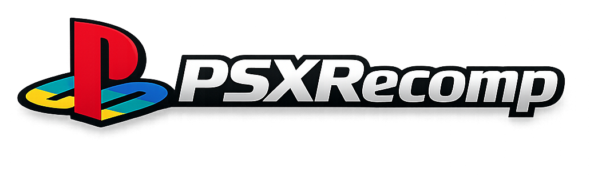

[English](README.md) · **Português (BR)**

<p align="center">
  
</p>

# PSXRecomp

Framework genérico de recompilação estática para PlayStation 1: MIPS R3000A para C para
x64 nativo.

Contexto do protótipo original:
[I Built a PS1 Static Recompiler With No Prior Experience (and Claude Code)](https://1379.tech/i-built-a-ps1-static-recompiler-with-no-prior-experience-and-claude-code/)

[](https://www.youtube.com/watch?v=CID9oVhgCyY)

## O que é

O PSXRecomp traduz binários MIPS de PS1 para C e compila esse C como um
executável nativo ligado a um runtime de hardware de PS1. A arquitetura v4
recompila a BIOS real SCPH1001 e a executa como kernel. Não há camada de BIOS
HLE, nem stubs, nem fallback para um interpretador de uso geral no código estático.

O PSXRecomp é um framework. Projetos específicos de jogos vivem em seus próprios
repositórios e usam este aqui para compilar o binário do jogo. Os alvos ativos
ponta a ponta são:

- [TombaRecomp](https://github.com/mstan/TombaRecomp) — *Tomba!*
- [MegaManX6Recomp](https://github.com/mstan/MegaManX6Recomp) — *Mega Man X6*
- [Brave Fencer Musashi Recompiled](https://github.com/saironbusatto/MusashiRecomp) — *Brave Fencer Musashi*

## Filosofia — rumo à recompilação 100% estática

O objetivo é simples e absoluto: **um jogo de PS1 deve rodar como código nativo, não ser
emulado.** Toda instrução MIPS que o jogo executa deveria, idealmente, ter sido
traduzida para C e compilada antecipadamente. Nenhum interpretador no caminho crítico, nenhum
shim HLE, nenhuma aproximação "boa o suficiente" do hardware — a BIOS recompilada
*é* o kernel, e o jogo recompilado *é* o jogo.

Jogos de PS1 tornam esse objetivo difícil de uma forma específica: **overlays.** Os jogos carregam
código do disco para a RAM em tempo de execução e o executam, depois sobrescrevem com o
próximo overlay. Esse código não existe no executável em tempo de build, então um
recompilador puramente ahead-of-time não consegue vê-lo. Essa é a fronteira em que o projeto
está trabalhando, e é por isso que ele é **alfa/beta**: hoje uma *maioria* de um
jogo suportado roda como código nativo recompilado estaticamente, mas **ainda não 100%.**

Como fechamos a lacuna, sem nunca comprometer a correção:

1. **Estático primeiro.** O executável principal e a BIOS são totalmente recompilados
   antecipadamente. Esse é o grosso da execução e é sempre nativo.
2. **Capturar → compilar → cachear os overlays.** Enquanto o jogo roda, os overlays são
   capturados no momento em que carregam. Offline, cada um é recompilado em uma DLL nativa
   identificada pelo seu conteúdo, cacheado, e nas execuções seguintes carregado e despachado como
   código nativo *antes* de qualquer fallback. A cobertura cresce conforme o jogo é jogado:
   todo overlay que alguém alcança passa a ser nativo para todos depois.
   No Brave Fencer Musashi, os arquivos de overlay do disco são decodificados
   diretamente (`tools/musashi_disc_overlays.py`), e ~95 mil funções de overlay
   são compiladas no executável antecipadamente, inclusive de áreas que ninguém
   jogou ainda (`docs/overlay-discovery.md`).
3. **Failover para o interpretador — só para código que ainda não é estático.** Um pequeno
   interpretador MIPS executa código *instalado em tempo de execução* (overlays/RAM suja) que
   ainda não foi capturado e compilado. É uma rede de segurança e um alimentador de cobertura,
   nunca um substituto da recompilação de código estático, e nunca no caminho da BIOS/EXE principal.
4. **Precisão acima de cobertura.** Um trecho de código que *não* compilamos com segurança cai
   no interpretador e é capturado para a próxima vez — a subcobertura se
   autocorrige. Um trecho que compilamos *errado* corromperia a máquina, então o
   sistema pende fortemente para a correção: código nativo só é despachado quando sua
   RAM de origem está comprovadamente inalterada, e um registro é revogado no instante
   em que a RAM a partir da qual ele foi compilado é sobrescrita.

Dois limites honestos. **O pior caso é sempre desempenho, nunca correção** —
qualquer coisa que ainda não é nativa simplesmente roda interpretada, corretamente.

**Caso limítrofe conhecido — código genuinamente automodificável / relocado a cada carga.** Algum
código é reescrito ou relocado para *bytes diferentes a cada carga*, logo não é
estático por definição e não pode ser recompilado antecipadamente em uma única
tradução correta. **Esse código continua interpretado** — permanentemente, tanto quanto
o desenho atual alcança, e esse é um resultado aceito e correto (o
interpretador o executa fielmente; só se perde velocidade). É um canto estreito, não
um muro. **Podemos, algum dia, tentar cobri-lo** — por exemplo, detectando o
padrão de relocação/patch e fixando-o em tempo de compilação (identificado pelos parâmetros
de relocação), ou compilando em tempo de carga — mas não prometemos nada, e o
projeto é plenamente correto sem isso.

A aspiração é **100% de cobertura estática** — toda instrução alcançável nativa,
o interpretador ocioso. O ciclo de captura e recompilação converge para isso quanto mais
o jogo é jogado; este branch é onde essa maquinaria está sendo construída.

## Status

Marco atual em 2026-07-08:

| Subsistema | Estado |
|---|---|
| Recompilação da BIOS (`SCPH1001.BIN`) | Inicializa e passa o controle ao jogo |
| Recompilação do EXE do jogo | Tela-título, OPTIONS, NEW GAME, salvar/carregar e gameplay do Tomba alcançados. BFM passa do título para o gameplay |
| CD-ROM / MDEC / XA | FMVs do Tomba fazem streaming e tocam a 15 fps; BFM carrega do disco |
| Memory cards | Salvar e carregar do Tomba verificados |
| Controles SIO0 | Polling do controle digital e respostas de configuração do DualShock |
| GPU | Funcional para boot da BIOS, FMVs, menus e gameplay |
| Interrupções, COP0, timers | Funcionando nos caminhos de jogo atuais |
| Suporte a RAM suja | Caminhos de despacho instalados em RAM da BIOS/jogo tratados; guarda de janela do kernel evita despachar overlay obsoleto no boot |
| Entrada de controle | Teclado e mapeamento de controle estilo SDL/XInput via `input.ini` |
| Cache de overlay (Linux) | dlopen POSIX + varredura de diretório com dirent.h para cachear overlays compilados do jogo. Captura overlays carregados por CD DMA e os despacha como DLLs nativas |

Trabalho de acompanhamento conhecido:

- O recente burn-down visual do Tomba corrigiu o logo PS da BIOS, as emendas de glifos do
  título/menu, as emendas dos painéis de diálogo/pausa, o sombreamento do terreno e a renderização
  de ramificações com textura sombreada observada na primeira área.
- A cobertura de SPU é parcial; reverb, ruído, sweep e o comportamento preciso de IRQ da SPU
  não estão completos.
- O histórico travamento "Not Responding" no Windows está mitigado, mas deve continuar na
  lista de observação até que testes de imersão mais longos fiquem limpos.
- Nenhum dos jogos está totalmente validado ponta a ponta ainda. Tomba tem consideravelmente mais
  cobertura; Mega Man X6 está jogável (fases, controle e salvar/carregar
  em memory card funcionam). Brave Fencer Musashi passa da tela de título
  e chega ao gameplay, mas ainda precisa de trabalho na estabilidade do cache de overlays.
  Playthroughs completos de todos os alvos continuam não verificados.

Para o marco atual do jogo, compile e rode o projeto irmão TombaRecomp:

```sh
cd ../TombaRecomp
cmake --build build -j16
./build/psx-runtime.exe --game game.toml
```

Rodar o runtime deste repositório sem `--game` continua útil para
gerenciar memory cards apenas com a BIOS.

## Pacote de release

> **Alpha — ninguém terminou o jogo neste build ainda.** Ele inicia, roda e
> salva, mas um crash ou travamento mais adiante no jogo é possível. Mantenha um
> save no memory card e um backup do `card1.mcd` conforme avança.

Brave Fencer Musashi Recompiled sai para **Windows x64** e **Linux x86_64**:

1. Baixe em Releases: `MusashiRecomp-v*-windows-x64.zip` ou
   `MusashiRecomp-v*-linux-x86_64.AppImage`.
2. Windows: extraia e rode `MusashiRecomp.exe`. Linux: dê `chmod +x` no
   AppImage e rode (precisa de `zenity` ou `kdialog` para o seletor de arquivos).
3. No launcher, selecione sua BIOS (`SCPH1001.BIN`) e o dump do seu próprio
   disco (`.cue`, SLUS-00726). O launcher verifica o disco.

Os pacotes **não** contêm BIOS de PS1, imagem de disco nem saves — você fornece
suas próprias cópias obtidas legalmente, como em todo recomp. Configurações,
memory cards e o cache de overlays ficam ao lado do exe no Windows e em
`~/.local/share/MusashiRecomp/` no Linux. O jogo inicia em 4:3; o 16:9 é uma
opção experimental em Settings.

Mantenedores geram os dois pacotes com `tools/release/package.sh all <versão>`
(Docker; precisa do código gerado localmente, que nunca é commitado).

## Instalação

Compila nativamente em **Windows (MSVC/MinGW)**, **macOS (Apple Silicon & Intel)**
e **Linux**. O escalonador de threads da BIOS usa fibras do host — Win32 Fibers no
Windows, `ucontext` no POSIX (`runtime/src/psx_fiber.c`) — então a troca cooperativa de threads da BIOS
recompilada (a passagem de controle do boot por CD em particular) se comporta
igual em todas as plataformas.

Requisitos:

- Uma toolchain C/C++: MSVC ou MinGW (Windows), Apple Clang (macOS), Clang/GCC (Linux).
- CMake 3.20+. Em macOS/Linux também `ninja` e `pkg-config`.
- SDL2: o pacote dev incluído no Windows; `brew install sdl2 pkg-config ninja`
  no macOS; `libsdl2-dev` (ou equivalente da distro) no Linux.
- Uma cópia de BIOS `SCPH1001.BIN` obtida legalmente. Não incluída.
- Para projetos de jogo, uma cópia de disco/EXE do jogo obtida legalmente. Não incluída.

Compilar o runtime do framework:

```sh
# Windows (MSYS2/MinGW)
cmake -S recompiler -B recompiler/build -G "Unix Makefiles" && cmake --build recompiler/build
cmake -S runtime    -B runtime/build    -G "Unix Makefiles" && cmake --build runtime/build --target psx-runtime

# macOS / Linux (Ninja)
cmake -S recompiler -B recompiler/build -G Ninja -DCMAKE_BUILD_TYPE=Release && ninja -C recompiler/build
cmake -S runtime    -B runtime/build    -G Ninja -DCMAKE_BUILD_TYPE=Release && ninja -C runtime/build psx-runtime
```

Os projetos de jogo geram seus próprios arquivos `generated/<serial>_*.c` e ligam esta
árvore de código do runtime via CMake.

## Mapa de teclado

| Botão do PSX | Teclado |
|---|---|
| D-Pad cima / baixo / esquerda / direita | Setas |
| Cross | X |
| Quadrado | Z |
| Círculo | S |
| Triângulo | A |
| L1 / R1 | Q / W |
| L2 / R2 | E / R |
| Start | Enter |
| Select | Shift direito |
| Turbo | Tab (segurar) |
| Tela cheia | F11 / Alt+Enter / Cmd+F |

## Mapa de controle

Os padrões para controle estilo Xbox são ativados quando um controle é conectado:

| Botão do PSX | Controle Xbox |
|---|---|
| D-Pad cima / baixo / esquerda / direita | D-pad ou analógico esquerdo |
| Cross | A |
| Círculo | B |
| Quadrado | X |
| Triângulo | Y |
| L1 / R1 | LB / RB |
| L2 / R2 | LT / RT |
| Start | Menu |
| Select | View / Back |

Builds de release criam/usam `input.ini` ao lado do executável. Edite esse arquivo para
mudar o índice do dispositivo, a deadzone ou o mapeamento dos botões.

## Arquitetura

O recompilador emite funções C e tabelas de despacho para o código da BIOS e do jogo.
O runtime carrega os assets da BIOS/jogo na memória de PS1 emulada, liga o
C gerado como código nativo e simula o hardware por meio de handlers de MMIO para
GPU, DMA, timers, CD-ROM, MDEC, SIO0, memory cards, SPU, GTE e entrega de
interrupções. Os vetores A0/B0/C0 da BIOS passam pela BIOS recompilada, não por shims HLE.

Veja `CLAUDE.md`, `PLAN.md` e `FAITHFUL_TIMING_PLAN.md` para as regras de desenvolvimento
e o contexto atual do projeto.

## Velocidade do disco

O `disc_speed` por jogo em `game.toml [runtime]` comprime a temporização do CD-ROM:

| Valor | Efeito |
|---|---|
| `"1x"` | Temporização autêntica do PSX. Padrão para todos os jogos. |
| `"2x"` / `"4x"` | Leituras e buscas 2× / 4× mais rápidas. |
| `"instant"` | Atrasos no piso mínimo. **Sabe-se que trava alguns jogos** durante a inicialização inicial; causa raiz ainda não identificada. Use `"4x"` até resolver. |

A reprodução de FMV é sempre protegida: a camada de CD-ROM volta para 1× sempre que o streaming
de áudio XA está ativo, independentemente do `disc_speed`. A troca de velocidade só entra
depois que a BIOS passa o controle ao EXE do jogo — o boot e a tela de licença
sempre rodam em 1× autêntico.

## Ajude a deixar seu jogo mais rápido — só jogando

**Por que o jogo ainda não está em velocidade máxima em todo lugar?** A maior parte do código de um jogo é
convertida ("recompilada") em um programa nativo rápido antecipadamente.
Mas jogos de PlayStation não mantêm todo o seu código em tela ao mesmo tempo — eles
carregam blocos extras de código do disco conforme você chega a áreas novas (esses
blocos são chamados de *overlays*). Não conseguimos converter um bloco que nunca vimos,
e a única forma de vê-lo é alguém realmente visitar aquela área.
Até lá, o código daquela área roda em um modo de compatibilidade mais lento.

**Você pode ajudar, apenas jogando.** Enquanto você joga, o jogo percebe discretamente
quais áreas ainda rodam no modo lento, tira um snapshot delas
e as converte em código nativo rápido em segundo plano — muitas vezes em menos de
um minuto, enquanto você continua jogando. Quanto mais lugares você visita, mais rápido o
jogo fica. Isso acontece automaticamente; você não precisa fazer nada.

**Suas descobertas persistem para você.** Elas são salvas em um arquivo escrito ao lado
do jogo chamado `overlay_captures.json`, e seu cache local é reconstruído
a partir dele automaticamente — as áreas que você visitou continuam rápidas em todas as sessões
seguintes.

**Por favor, não publique `overlay_captures.json`.** O arquivo contém
snapshots literais do código do jogo lidos do seu disco, que é material
protegido por direitos autorais — mantenha-o na sua máquina, junto com a sua imagem
de disco. Um formato de contribuição apenas com metadados (endereços e checksums, sem
código de jogo) está planejado para que as descobertas possam ser compartilhadas com segurança no futuro.

## Licença

PolyForm Noncommercial 1.0.0. Veja `LICENSE`.

A BIOS do PSX e as imagens de disco dos jogos continuam protegidas por direitos autorais de seus respectivos
donos. Este projeto não distribui imagens de BIOS, imagens de disco nem
assets de jogo — eles são sempre fornecidos pelo usuário a partir da própria
coleção. Os executáveis de release (e os caches de overlay por jogo) contêm
builds recompilados estaticamente (traduzidos por máquina) do código original,
o mesmo modelo de distribuição usado por outros projetos de recompilação estática
como N64: Recompiled.

---

<p align="center">
  <sub><b>R.A.I.D. — Retro AI Development</b> · um Discord para engenharia reversa, decomp &amp; recomp retrô assistidos por IA</sub>
</p>

<p align="center">
  <a href="https://discord.gg/Ad9BwSzctP"></a>
</p>
